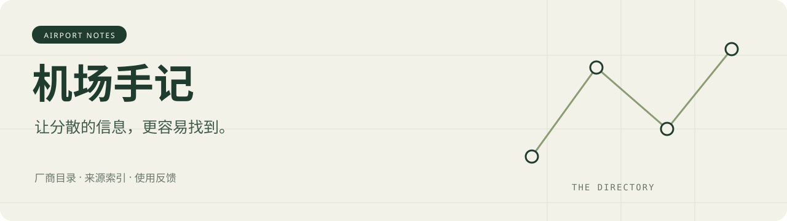

<!-- 自动生成：python tools/build.py build -->

# 机场手记 · 机场黄页

查机场、对照套餐、找到原始资料。整理 VPN 与代理订阅服务的官网、公开报价、产品说明和使用反馈。

**整理日期：2026-10-23** · 10 家厂商 · 9 家有参考套餐 · 2 家已接入邀请注册

[厂商速查](#厂商速查) · [参考套餐](#参考套餐) · [按需求找](#按需求找) · [怎么选](docs/choosing.md) · [补充收录](CONTRIBUTING.md)

标为“邀请注册”的入口均使用本站维护者提供的邀请链接，符合条件的购买可能为维护者产生佣金。[推广关系与来源说明](docs/disclosure.md)。收录不等于质量推荐，官网宣传和第三方评价均注明出处。

## 厂商速查

点击“邀请注册”通过本站邀请链接前往厂商注册，点击厂商名了解详细资料。已有邀请入口的条目先展示，其余保留为资料条目，等待补充邀请链接；顺序不代表质量排名。

| 厂商 | 信息要点 | 可追溯资料 | 邀请注册 |
| --- | --- | --- | --- |
| [苏菲家宽](reviews/sufe.md) | 住宅代理线索 / 自有客户端线索 | 有来源资料 · 2026-10-23 | [邀请注册](https://sufe.us/register?code=UqMAwue5) |
| [雪山 Link](reviews/xueshan.md) | 月付 / 按量 / 直连线索 / 自有客户端线索 | 有来源资料 · 2026-10-20 | [邀请注册](https://www.xueshan.shop/#/register?code=5Rl9uaQh) |
| [边界云](reviews/bianjiecloud.md) | 年付 / 季付 / 按量 / 自有客户端线索 | 有来源资料 · 2026-10-20 | 邀请链接待补 |
| [星链机场](reviews/xship.md) | 月付 / 地区覆盖线索 | 有来源资料 · 2026-10-20 | 邀请链接待补 |
| [白月光](reviews/baiyueguang.md) | 季付 / 专线线索 | 待核验线索 · 2026-10-20 | 邀请链接待补 |
| [飞鸟云](reviews/feiniaoyun.md) | 按量 / 地区覆盖线索 | 待核验线索 · 2026-10-20 | 邀请链接待补 |
| [果冻加速](reviews/guodong.md) | 月付 / 流量规则待核实 | 待核验线索 · 2026-10-20 | 邀请链接待补 |
| [落云](reviews/luoyun.md) | 月付 / 地区覆盖线索 | 待核验线索 · 2026-10-20 | 邀请链接待补 |
| [鲨鱼云](reviews/shayuyun.md) | 月付 / 家宽线索 | 待核验线索 · 2026-10-20 | 邀请链接待补 |
| [TAG](reviews/tag.md) | 月付 / 家宽线索 | 待核验线索 · 2026-10-20 | 邀请链接待补 |

## 参考套餐

以下是公开来源的报价摘录。**年付显示一次付款总额，流量重置周期另列。第三方报价尚未由本项目核对当前售价。**没有价格的厂商仍保留在黄页，付款前以结算页为准。

| 厂商 / 套餐 | 付款总额 / 周期 | 流量 | 出处与摘录日期 | 邀请注册 |
| --- | --- | --- | --- | --- |
| [雪山 Link](reviews/xueshan.md) · 月付报价线索 | ¥9.9 / 月付 | 500 GB（周期待核实） | [第三方公开资料](reviews/xueshan.md#%E5%8E%9F%E5%A7%8B%E6%9D%A5%E6%BA%90) · 2026-10-20 | [邀请注册](https://www.xueshan.shop/#/register?code=5Rl9uaQh) |
| [雪山 Link](reviews/xueshan.md) · 按量报价线索 | ¥39.9 / 一次购买 | 1500 GB（总量） | [第三方公开资料](reviews/xueshan.md#%E5%8E%9F%E5%A7%8B%E6%9D%A5%E6%BA%90) · 2026-10-20 | [邀请注册](https://www.xueshan.shop/#/register?code=5Rl9uaQh) |
| [边界云](reviews/bianjiecloud.md) · 云帆 | ¥189 / 年付 | 100 GB（每月） | [厂商说明](reviews/bianjiecloud.md#%E5%8E%9F%E5%A7%8B%E6%9D%A5%E6%BA%90) · 2026-10-20 | 邀请链接待补 |
| [边界云](reviews/bianjiecloud.md) · 星河 | ¥228 / 季付 | 500 GB（每月） | [厂商说明](reviews/bianjiecloud.md#%E5%8E%9F%E5%A7%8B%E6%9D%A5%E6%BA%90) · 2026-10-20 | 邀请链接待补 |
| [边界云](reviews/bianjiecloud.md) · 按量流量包 | ¥50 / 一次购买 | 50 GB（总量） | [厂商说明](reviews/bianjiecloud.md#%E5%8E%9F%E5%A7%8B%E6%9D%A5%E6%BA%90) · 2026-10-20 | 邀请链接待补 |
| [星链机场](reviews/xship.md) · 月付报价线索 | ¥12 / 月付 | 188 GB（周期待核实） | [第三方公开资料](reviews/xship.md#%E5%8E%9F%E5%A7%8B%E6%9D%A5%E6%BA%90) · 2026-10-20 | 邀请链接待补 |
| [白月光](reviews/baiyueguang.md) · 季付报价线索 | ¥66 / 季付 | 100 GB（周期待核实） | [第三方公开资料](reviews/baiyueguang.md#%E5%8E%9F%E5%A7%8B%E6%9D%A5%E6%BA%90) · 2026-10-20 | 邀请链接待补 |
| [飞鸟云](reviews/feiniaoyun.md) · 按量报价线索 | ¥10 / 一次购买 | 200 GB（总量） | [第三方公开资料](reviews/feiniaoyun.md#%E5%8E%9F%E5%A7%8B%E6%9D%A5%E6%BA%90) · 2026-10-20 | 邀请链接待补 |
| [果冻加速](reviews/guodong.md) · 月付报价线索 | ¥9.9 / 月付 | 流量额度待核实 | [第三方公开资料](reviews/guodong.md#%E5%8E%9F%E5%A7%8B%E6%9D%A5%E6%BA%90) · 2026-10-20 | 邀请链接待补 |
| [落云](reviews/luoyun.md) · 默认月付报价线索 | ¥16 / 月付 | 300 GB（周期待核实） | [第三方公开资料](reviews/luoyun.md#%E5%8E%9F%E5%A7%8B%E6%9D%A5%E6%BA%90) · 2026-10-20 | 邀请链接待补 |
| [鲨鱼云](reviews/shayuyun.md) · 默认月付报价线索 | ¥20 / 月付 | 100 GB（周期待核实） | [第三方公开资料](reviews/shayuyun.md#%E5%8E%9F%E5%A7%8B%E6%9D%A5%E6%BA%90) · 2026-10-20 | 邀请链接待补 |
| [TAG](reviews/tag.md) · 默认月付报价线索 | ¥114 / 月付 | 500 GB（周期待核实） | [第三方公开资料](reviews/tag.md#%E5%8E%9F%E5%A7%8B%E6%9D%A5%E6%BA%90) · 2026-10-20 | 邀请链接待补 |

## 按需求找

标签是产品信息的检索入口；家宽、专线等为相应来源的描述，实际表现请结合原文和自己的网络判断。

**专线线索**：[白月光](reviews/baiyueguang.md)

**住宅代理线索**：[苏菲家宽](reviews/sufe.md)

**地区覆盖线索**：[星链机场](reviews/xship.md) · [飞鸟云](reviews/feiniaoyun.md) · [落云](reviews/luoyun.md)

**季付**：[边界云](reviews/bianjiecloud.md) · [白月光](reviews/baiyueguang.md)

**家宽线索**：[鲨鱼云](reviews/shayuyun.md) · [TAG](reviews/tag.md)

**年付**：[边界云](reviews/bianjiecloud.md)

**按量**：[雪山 Link](reviews/xueshan.md) · [边界云](reviews/bianjiecloud.md) · [飞鸟云](reviews/feiniaoyun.md)

**月付**：[雪山 Link](reviews/xueshan.md) · [星链机场](reviews/xship.md) · [果冻加速](reviews/guodong.md) · [落云](reviews/luoyun.md) · [鲨鱼云](reviews/shayuyun.md) · [TAG](reviews/tag.md)

**流量规则待核实**：[果冻加速](reviews/guodong.md)

**直连线索**：[雪山 Link](reviews/xueshan.md)

**自有客户端线索**：[苏菲家宽](reviews/sufe.md) · [雪山 Link](reviews/xueshan.md) · [边界云](reviews/bianjiecloud.md)

## 最近补充

- 边界云：补入官网年付、季付及按量套餐，区分一次付款额和每月流量。
- 雪山：补入品牌公告中的直连定位与历史波动说明。
- 苏菲：补入住宅代理定位和备用入口公示；套餐页价格仍待补。
- 第三方线索：保留来源报价和链接核查结果，方便继续了解。

## 参与维护

可以提交官网入口、价格变动、公开评测或亲身体验，无需先逐家购买。资料说明谁说的、何时看到、原文在哪；不知道的内容留空。

[如何选套餐](docs/choosing.md) · [资料整理方法](docs/methodology.md) · [提交资料](CONTRIBUTING.md) · [维护命令](docs/maintaining.md)

可直接复用 [公开目录数据](data/catalog.json)，或运行工具生成同样的首页与厂商档案。项目不提供节点或订阅配置。
